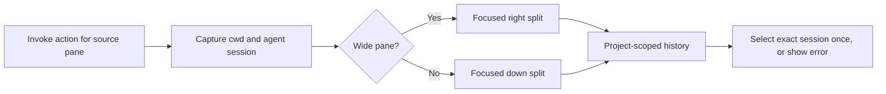

# Agent history beside a pane

The **Open agent history beside** plugin action captures the originating
pane's foreground directory, structured agent session, and layout before
opening a focused split. Wide panes split **right**; tall/narrow panes split
**down**. The shape comparison treats terminal cells as approximately twice
as tall as they are wide (`columns >= 2 × rows` splits right, including ties).
For a zoomed source pane, it uses the visible area rather than its hidden tiled
rectangle. History retains its usual cwd-based project scope and selects the
originating session once, without following later focus.

**Herdr 0.9.3 limitation:** its client-side right-click menu contains only
built-in actions; it does not render registered plugin actions, despite the
manifest's `contexts = ["pane"]`. Reloading config or reattaching does not
make this action appear there. Use **Ctrl+S, then A** with the tracked config,
or the CLI, until Herdr's client menu supports plugin actions.



## Install

Requires Python 3 and an `agent-history` executable supporting
`--select-session AGENT:KIND:VALUE`. The launcher also searches `~/util`,
`~/.local/bin`, and `~/.cargo/bin` for installations not in Herdr's inherited PATH.

```sh
make -C ~/agent-history build
herdr plugin link ~/.vim/herdr-plugins/agent-history
```

The normal `make bootstrap-herdr` links this plugin. With the tracked config,
focus the source pane and press **Ctrl+S, then A**; the keybinding helper labels
it **Open agent history beside**. Run `herdr server reload-config` after updating
an already-running server's config.

Alternatively, invoke the action from an external terminal while the desired
source pane is focused in Herdr:

```sh
herdr plugin action invoke local.agent-history.open
```

The action uses the **pane captured in its invocation context**, not whichever
pane becomes focused after the split. Session identity is passed as a literal process argument, never typed
into the source shell. Missing recognition passes an explicit empty selector;
invalid or unmatched identities produce a visible error in history instead of
silently ignoring the request. Active project/query/tag filters are not removed.
Errors creating the split appear as a Herdr notification and in the plugin log.

The split runs `term-capture → agent-history`, without an interactive shell.
Recordings use `~/.termplex/captures`; `TERMPLEX_CAPTURE_BIN` and
`TERMPLEX_CAPTURE_DIR` override the recorder and destination, as for automatic
zsh capture. `TERMPLEX_CAPTURE=0` or a missing recorder launches history unrecorded.
These settings must be present in the pane process environment (not just a source
shell's local environment). No parentage metadata is added yet.

Relationship indication is independent: aghist publishes a
**bold cyan `[aghist]` badge** beside its selected session in Herdr's
**Agents** and **Spaces** sidebars. Selection
changes and manual interaction renew a five-second TTL; idle history does not.
Switching sessions clears the previous pane badge and, if different, its
workspace badge before marking the new target. Unmatched sessions clear both.
Idle badges still expire naturally; another interaction rematches moved panes.
This action itself does not publish markers, change agent lifecycle state, or
enable history's follow-Herdr mode. Only **Ctrl+O** explicitly navigates; markers
never steal focus. With `local.pane-load` running, the same pane token also shows
plain-text `[aghist]` before its CPU header. Pane-load keeps the CPU feed intact
and uses a separate five-second title TTL; clearing or expiring the token reveals
the normal header. Without the sampler, sidebar markers still work.

```text
selection / manual input → exact session match → clear previous target
                                              → pane + workspace tokens
                                                   ├→ sidebars
                                                   ├→ pane-load header [aghist]
                                                   └→ expire after 5 s idle
```

## Test

```sh
python3 ~/.vim/test-herdr-open-history.py
```

The tests use executable stubs and do not modify live Herdr panes.
