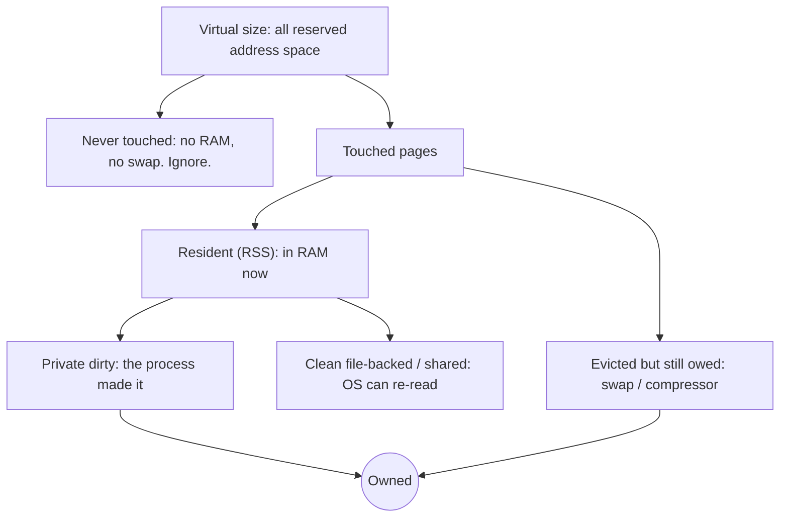
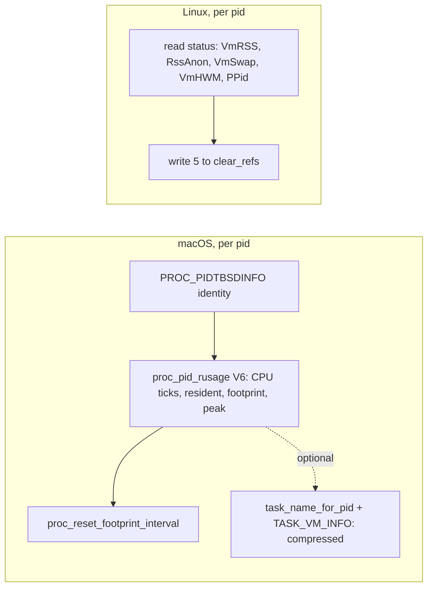

# Memory metrics: what the recorder should sample

**Status: proposal, measured 2026-10-18.** Not implemented. Today the recorder stores
one memory value, RSS (`pti_resident_size`, floored to 256 KiB). Measurements below
come from an M1 Max (macOS 15.7.4, 64 GB, ~1170 pids, ~940 readable unprivileged)
and the NAS (Linux 6.18 x86_64, ~1170 pids). Probe sources: [`probes/memory/`](probes/memory/).

## Problem

RSS answers "what is in RAM right now", not "what does this process use":

- **It drops when pages are evicted.** On macOS a process can have far more in the
  compressor than in RAM (one VM process here: 456 MB resident, 9.9 GB compressed).
- **It counts shared and clean file pages** (libraries, mmapped files) that the OS can
  drop and re-read at any time.
- **A point sample misses spikes** between samples, and that gets worse when the
  interval goes from 100 ms to 500 ms.

VSZ is worse still. It counts address space that was reserved but never touched.



What we want is **owned** memory: private dirty pages plus evicted pages. The diagram
shows why that is neither RSS nor VSZ.

## Recommendation: four columns

| Column | Meaning | macOS source | Linux source (`/proc/pid/status`) |
|---|---|---|---|
| **owned** | private memory, including evicted | `ri_phys_footprint` | `RssAnon` + `VmSwap` |
| **resident** | in RAM now (today's RSS) | `ri_resident_size` | `VmRSS` |
| **peak** | highest value since the previous sample | `ri_interval_max_phys_footprint`, then reset | `VmHWM`, then `clear_refs` reset |
| **evicted** | owned pages not in RAM, pre-compression bytes | `TASK_VM_INFO.compressed` | `VmSwap` |

Why each column earns its place:

- **owned** is the primary metric, and the one that answers the original finding.
- **resident** keeps continuity with existing recordings. The gap between owned and
  resident is the paging signal.
- **peak** makes 500 ms sampling safe. Probe: a child that touched 300 MB and unmapped
  it between samples read footprint 0.8 MB but interval max 301 MB on macOS, and
  RSS 0 MB but VmHWM 300 MB on Linux. Both resets then worked.
- **evicted** explains *why* resident dropped. It costs nothing on Linux and is the
  only optional extra call on macOS (see cost).

## Acquisition and cost



On macOS, `proc_pid_rusage(RUSAGE_INFO_V6)` **replaces** `PROC_PIDTASKINFO` rather than
adding a call. It returns the same CPU counters in the same native ticks
(`ri_user_time` = `pti_total_user`, timebase 125/3) and an identical resident size.
On Linux, every column comes from the `status` read the sampler needs anyway.

Measured full-system sweep cost (medians of repeated sweeps):

| Step | macOS (~1170 pids) | Linux NAS (1170 pids) |
|---|---|---|
| Base read | `PROC_PIDTASKINFO` 1.85 ms, `proc_pid_rusage` 1.84 ms | `status` 9.6 ms |
| Peak reset | 0.38 ms (~0.4 µs/pid) | ~3–4 µs/pid (own pids only unprivileged) |
| Compressed | +2.35 ms (`TASK_VM_INFO`) | free (`VmSwap`) |

At 500 ms this is about 1% of a core on macOS (~4.6 ms of memory calls, all
options on) and under 3% on Linux (≤14 ms when root resets every pid).

## Caveats

1. **The macOS peak reset is a private API.** `proc_reset_footprint_interval` is
   exported from libSystem but absent from SDK headers. If it disappears,
   `ri_lifetime_max_phys_footprint` (public) still catches new all-time peaks.
2. **Resets are shared per-process state.** Only one sampler may reset. If the UI
   sampler and the recorder both reset, each steals the other's peaks.
3. **Linux "peak" is peak RSS, not peak owned.** `VmHWM` includes file pages, so the
   macOS and Linux peak columns are not identical. Interpret them per OS.
4. **Compressed is not nested inside footprint.** 39 of 933 readable macOS processes
   report compressed > footprint (mostly by a few MB; the VM process 9.9 GB vs
   6.0 GB). Store columns independently and never derive one from the other.
5. **Coverage matches today's.** macOS unprivileged reads cover own-user pids
   (~940 of ~1170), the same set `PROC_PIDTASKINFO` covers now. Linux `status` covers
   all pids, but `clear_refs` resets only own pids unless root.
6. **Linux `RssShmem` is left out of owned.** Shared-memory buffers (browsers, GPU
   clients) are real but ambiguous to attribute. Revisit if they matter.
7. **Sums are not a RAM total.** macOS footprint summed to ~80 GB on a 64 GB machine,
   largely because compressed memory counts at its uncompressed size
   (`vm_stat`: ~74 GB stored in a ~25 GB compressor).

## Encoding notes

- Floor all four columns to the existing 256 KiB unit.
- Store **peak as excess over owned** (`peak − owned ≥ 0`). It is zero whenever
  memory did not spike or fall, so it compresses to almost nothing.
- **evicted** is zero for most Linux processes and for idle macOS ones.
- Each new column needs its own change-mask bit next to the current `RSS` bit, which
  means a wire version bump. Add all of them in one bump.

## Open decisions

- Include **evicted** on macOS (one extra call per pid)? Recommended: yes.
- Accept the private reset API, or use lifetime max only?
- Accept the macOS/Linux semantic mismatch in **peak**?

## Reproduce

```sh
cd probes/memory
cc -O2 -o /tmp/sweep sweep_cost.c && /tmp/sweep    # both OSes: sweep cost
cc -O2 -o /tmp/api macos_api_probe.c && /tmp/api   # units parity, call costs
cc -O2 -o /tmp/spk macos_spike.c && /tmp/spk       # interval max catches spike
cc -O2 -o /tmp/cmp macos_compressed.c && /tmp/cmp  # compressed vs footprint
cc -O2 -o /tmp/rst macos_reset_cost.c && /tmp/rst  # reset sweep cost
cc -O2 -o /tmp/lsp linux_spike.c && /tmp/lsp       # Linux: VmHWM + clear_refs
```
