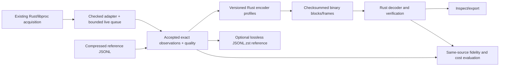

# Rust process history: buildout plan

**For review before implementation.** Build the complete Rust recording path,
not only an offline accelerator: canonical observations, adaptive binary encoding,
native live recording, compressed JSONL compatibility and evaluation tools. Rust
owns supported formats/decoders; Python remains an experiment and independent
reference tool. This is the single plan; historical proposals stay in Git.

## One core, live and replay inputs



**Canonical observations are the logical model, not one compressed byte layout.**
Retain sequence, actual wall/monotonic scan bounds, run/boot/process identity,
name/PPID, separate native user/system counters, RSS bytes, units and quality before
applying precision. The existing UI `Process` stores normalized ns; the recording
adapter must retain raw task counters plus the timebase before that conversion.
Different named encoder profiles consume the same observations; no plugin registry
or general serialization framework is needed.

- Live input goes straight from native observations to the encoder: **no JSONL or
  Python round trip in the default production path**.
- Keep existing JSONL/`.jsonl.zst` captures readable. Offer compressed JSONL as an
  optional source/reference recording format, preserving raw fields and declaring
  schema/units/quality explicitly. Check native-counter round trips; never silently
  change legacy tuple units or infer a foreign capture's timebase from the current
  host. Use source metadata or an explicit legacy-import setting. Uncompressed
  JSONL is for pipes/small tests, not the default disk format. Start from the measured zstd-3 reference setting. Select
  binary or compressed JSONL output; production dual-writing is not required.
  Any debug/test mirroring uses the same accepted observations after queue/gap
  handling. After a crash compare only the common committed prefix of two outputs.
- Compressed JSONL is the lossless comparison source. The existing 1-ms/256-KiB
  binary cache is already quantized: use it for **codec/framing** experiments, not
  as ground truth for finer precision or exact RSS. No additional raw binary-cache
  format is required initially; fast Rust replay can reread compressed JSONL.
- Decoded binary observations describe their precision and unavailable fields.
  Do not invent user/system components or label JSONL exported from lossy binary
  as an original lossless source capture.

## Extend pane-load without coupling recording to Herdr

Use the existing Rust crate/executable, adding a `recording` command namespace
alongside `start`, `stop`, `worker` and `benchmark`. Keep the current Cargo startup
and plugin manifest behavior intact; another binary/separate crate is unnecessary.
Put codec/model logic in testable modules, with a narrow native-input adapter.
Reuse libproc FFI rather than copying the sampler or rewriting the UI subsystem.

| Proposed command | Required purpose |
| --- | --- |
| `pane-load recording record` | Foreground native recording; binary default, compressed JSONL option; finite duration for tests. |
| `pane-load recording transform` | Stream existing compressed/plain JSONL files or capture sets through a chosen Rust profile. |
| `pane-load recording inspect` | Validate archive/cache, summarize coverage/quality/precision, and export explicitly labelled decoded observations. |
| `pane-load recording bench` | Same-source named profile/codec settings and cached-binary inputs; machine-readable metrics. |

These are small entry points into the same core, not four independent pipelines.
Keep profiles finite: the legacy fixed-1-ms parity control and the new adaptive
layout, whose policy can also use a constant quantum for controls. Do not build a
separate encoder for each precision setting or port every Python experiment.
Rust owns binary packing/framing as well as encoding/decoding; Python is not needed
to assemble a production recording.
Use `brotli` (pure Rust), `zstd` (libzstd bindings), existing `sha2`, and `serde`
derive with `serde_json` for typed streaming input. No codec CLI subprocesses at
runtime. Pin/review dependency versions; one CLI interop test checks decoding and
cost/size against current measurements, not identical compressed bits. Brotli-5,
~1 MiB window and 16 MiB frame input are the starting control. `bench` evaluates
named profiles and emits metrics; do not port the Python sweep orchestration.

## CPU, RSS and quality contract

- **Adaptive CPU is required**, not a follow-up after a fixed-only port. Base its
  precision on interval CPU/rate, not lifetime CPU. Use actual observed elapsed
  time; a singleton has no interval rate and gaps are not invented 100 ms buckets.
- Proposed adaptive-v1 policy: derive a native-tick quantum from powers of two,
  no larger than **1/8 of the observed interval increment**, with an explicit 1 ms
  cap (the cap need not be a power of two) and a one-native-tick floor. In symbols:
  `Q = max(1, min(Q_1ms, pow2_floor(delta_ticks / 8)))`.
  Increments below eight ticks use Q=1 and are exact. This targets <12.5% interval
  CPU error while retaining fine detail near zero; 1 ms is the maximum step where
  source units permit, not a sampling interval. A coarser source unit uses exact
  native counters and declares that limitation rather than claiming 1 ms resolution. Define integer rounding explicitly. Fixed 1 ms / 100 us and
  the previously discussed bands remain comparison controls, not more required
  production formats. These are source-relative bounds, not physical accuracy.
- Form runs from **maximal consecutive intervals with the same selected Q_i**.
  Zero intervals select Q_i=1; do not take a whole block's minimum positive Q and
  silently keep coarse idle intervals. For run intervals a..b, A=C[a-1] and C[b]
  are exact shared anchors; decode interiors as `A + floor((C[i]-A)/Q) * Q`.
  The anchor appears once as an observation. Q_1ms is 1 ms converted to stream ticks,
  rounded down; supported minimum units/rounding are explicit.
- Thus every valid interval has absolute CPU-increment error <Q_i (Q_i=1 is exact)
  and positive intervals have <12.5% relative error. Observed zero must decode zero;
  positive increments must not disappear. A busy-to-idle switch creates an exact
  shared boundary before the idle interval. Extra zero/nonzero anchors are not
  needed under this per-interval run rule. The buffered block permits a two-pass
  encoding decision; no rewriting published observations or accumulating debt.
- A block cut ends every run; each process track begins/ends the block at exact
  native anchors. An ordinary cross-block interval joins two exact observations
  and belongs to no run. A first lifetime observation has no preceding interval;
  quality cuts/state expiry mark continuity unavailable, even with exact counters.
- Store each run's Q explicitly. Any later merging/hysteresis must use a run Q no
  larger than every interval's Q_i, **zeros included**; a run containing zero must
  use Q=1. Specify/test point and interval bounds before freezing adaptive-v1 bytes.
  No independently rounded increments or accumulating drift. Version the CPU
  layout/policy, not old fixed-Q CSH1 labels.
- CPU binary profiles remain total-only; raw observations/reference retain user and
  system separately for validation. RSS remains **256 KiB floor precision on the
  same nominal 10 Hz scan cadence**. Sparse changes omit unchanged values, not
  observation times. RSS is a point reading, not a 100 ms average.
- Adopt the full-review anomaly behavior: preserve observed component decreases,
  cut continuity at an exact baseline before selecting Q, and record original
  before/after values and unavailable-rate intervals. Negative deltas are never
  quantized. This is not proof of restart; do not clamp, drop
  records or hide component regression behind a growing sum. Include quality
  metadata in payload sizes. A strict verification mode may reject flagged input.
- Recording acquisition must distinguish failed/truncated enumeration from a true
  empty scan, and unreadable/raced processes from zero usage. Keep a checked
  recording adapter separate from the existing UI trait. Start with the tested
  BSD/task/BSD identity bracket; evaluate `PROC_PIDTASKALLINFO` only after verifying
  its ABI/lifetime guarantees, not assuming one call makes all metrics atomic.
- New macOS recording uses a named `mach_continuous_time` elapsed clock (includes
  suspend), explicit origin/timebase and wall anchors. Import legacy clock metadata
  as recorded, not as this new clock. Preserve scan uncertainty and wall steps;
  no promise of observing every short-lived process.

## Live daemon and storage design

```text
one native observer -> bounded observation queue -> Rust encoder/writer -> history
                    -> latest in-memory observations (future consumer adapter)
```

The independent `record` mode is the foreground daemon; it must work with no Herdr
socket or terminal capture. Consumers do not own its lifecycle and terminal
recording never waits for telemetry. The existing UI worker is unchanged initially;
it may still sample separately until migrated to the recorder's latest-observation
adapter. Do not claim single acquisition across both modes before that integration.

- One encoder/compression worker by default; no async framework or worker pool.
  Bound scan size, queue, active tail, codec expansion, disk growth and state.
  Overrun/full-disk behavior reports health and explicit gaps, not unbounded
  catch-up, fabricated zero samples or a blocked terminal-byte path. When a full
  queue cannot accept a gap marker either, accumulate dropped-scan counts/ranges
  and attach them to the next accepted observation or final run-status record.
- Block/frame cuts and live-state expiry use source sequence/timestamps, not writer
  scheduling time. Raw reference preserves run context, gaps and quality so replay
  can reproduce identical uncompressed blocks/framing. Cut frames at 16 MiB,
  one hour of source time, clean shutdown, or run end; never span recorder runs.
- A 16 MiB frame can span an hour: **do not buffer that hour solely in RAM**.
  Proposed default: append complete ~30s encoding blocks to a checksummed active
  journal and sync at that boundary. Target recoverable checkpoint age is ~30s
  during healthy operation, not a hard zero-loss guarantee through writer/OS stalls.
  Finalize frames from durable blocks. Give blocks run-scoped sequence numbers;
  frames include their block ranges/hashes so recovery cannot duplicate data.
  Derive final names from run/profile/block range. Reuse an existing frame only
  after verifying matching content; never overwrite a conflicting immutable frame.
- Commit order: write frame.tmp -> sync file -> rename -> sync directory -> update
  rebuildable manifest -> remove the committed journal. Frame publication after
  directory sync is authoritative, not manifest presence. Recovery verifies frames,
  deduplicates journal blocks already committed, then publishes the remainder.
  Use one journal per frame-in-progress, removed whole; no in-place prefix truncation.
  SIGTERM flushes/syncs the current block and publishes a valid partial frame.
- Use explicit boundaries, lengths, checksums, versions and units; recover only a
  verified active prefix and report discarded tails. Keep file counts/backlog
  bounded. No database or historical query daemon.
- Raw JSONL writes a closed zstd frame per encoding block, synced, with header only
  at the physical segment's start; concatenation decompresses to one JSONL stream.
  Rotate physical segments by the same age/size policy. A torn compressed tail is
  not a valid source frame. Source/import data is immutable.
- Keep stores private (0700/0600), enforce byte/free-space limits and exclusive
  writer ownership, and handle SIGTERM without confusing it with process exits.
  Full disk stops writes, reports health/gaps and **never deletes history by default**.
  Bound live identity state to current/recent identities (about one block of grace);
  expiry marks continuity unavailable, not falsely fully validated. Offline audit
  may retain longer history; measure that state growth separately.
- OS supervision is the eventual packaging direction. **No auto-install, enable,
  restart automation or change to existing Herdr startup** as part of buildout.
  Finite live smoke captures are tests, not a new unattended recording campaign.

## Tracer bullets and acceptance

1. **Tests/core/replay:** commit red golden/model tests, then implement the model,
   selected fixed-profile Rust control, decoder and compressed-JSONL input. Prove
   a real shard agrees with Python in retained values and canonical bytes where
   the old profile is unchanged. Existing plugin tests remain green. Do not let
   the encoder infer units, boot identity or original components absent from legacy
   metadata; make unavailable context explicit.
2. **Adaptive/full capture:** implement precision runs and quality flags; independent
   expected values/model tests validate boundaries and error bounds. Python remains
   a legacy oracle; no second full adaptive encoder/decoder is required. Process
   all 41 hours without dropping any source observations, retaining the 14 known
   flagged intervals. Freeze versioned golden vectors for adaptive-v1.
3. **Live/storage/tools:** connect native observations to the same core. Finite
   fake/native input, raw-reference replay and live binary tests close the loop;
   exercise signal shutdown, torn writes, recovery, blocked/failed compression,
   queue overflow, full disk, permissions and competing writers. Finish inspect
   and bench through these same paths, not separate ad hoc implementations.
   Keep the include-based Python capture shim working, or migrate its launcher to
   the new Rust entry point; module/dependency changes must not silently break it.
   Corrupt imported input must not produce a success manifest; identify partial
   outputs explicitly rather than promoting an unverified source prefix.

Across these bullets, test deterministic generated histories, PID reuse, missing/
returning identities, tiny/zero CPU, Unicode/name/PPID/RSS changes, backward wall
clocks, units/overflows, truncated prefixes and malicious expansion/length fields.
Cross-language agreement alone is not an independent oracle. Require uncompressed
block/framing parity for identical profiles/source partitions, not compressed-byte
parity across codec libraries. Readers must reject unsupported versions, corruption
and inconsistent counts/units without panic or unbounded allocation. Export must preserve availability/error semantics.

Measure wall time, total CPU per recorded hour/readings, peak RSS/state growth,
bytes and low-rate/false-idle/false-busy fidelity on identical source. Distinguish
codec CPU/input GiB from complete recorder cost; compare fixed controls fairly.
Larger data volume is acceptable for meaningful execution visibility.

## Existing evidence and remaining approval

The [scorecard](RECORDING_RESULTS.md) reports the completed 41h19m44s review:
1,487,845 scans / 1,413,925,731 readings; fixed-profile Brotli-5 ~100.84 MiB/day.
Python preparation cost ~4h37m / 1.99 GiB versus ~11 encoder CPU-seconds for Brotli-5.
Source/reference data stays private and gitignored under
`.recordings/2026-10-14-process-history/`; verified binary cache, quality evidence,
metrics and pinned code are under `.recordings/review-41h-python/`.
The [format guide](RECORDING_DATA.md) describes the measured Python prototype,
not an already built adaptive Rust implementation.

This replaces the narrower offline-only proposal. Opus 5.5 on `work2` reviewed it,
including a follow-up on adaptive-run math and recovery: no remaining blockers.
The adaptive contract was additionally checked against 61,049 deterministic
histories, including zero transitions and large lifetime baselines. This is plan
validation, not a claim that Rust code already exists. Ready for user approval of
the three tracer bullets; no further generic framework/design phase is needed.

Linux acquisition, Herdr/Strands/termplex adapters, timeline UI, filesystem history
and automatic service installation remain later work. Historical storage goals
remain unmet but are not a veto on richer-fidelity research.
