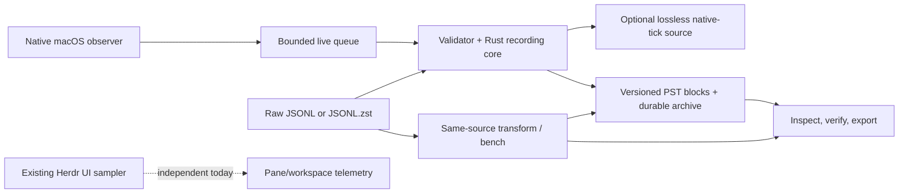

# Rust process-history recorder: implementation plan and status

**One current plan; no new design phase.** The user-approved buildout is implemented
in the existing `pane-load` binary: native capture, shared Rust validation/encoding,
archives, source transforms, inspection/export, and benchmarking. Full 41-hour
source-fidelity validation and the Opus 5.5/`work2` architecture/design review
are complete; review findings are fixed and tested.
The older Python codec work remains a measured reference, not the current recorder.



The standalone recording path does not depend on Herdr or terminal capture. The UI
sampler remains separate; recording has not been wired into it.

## Implemented scope

- `pane-load recording record` samples native process CPU components and RSS at
  10 Hz by default, directly from the macOS acquisition path. CPU stays in native
  ticks with an explicit timebase. Capture context records the `mach_continuous_time`
  origin/timebase, wall anchors, run/boot identity, and non-atomic scan method.
  There is no JSONL or Python round trip in this path.
- Raw-reference output uses `recording_source: 1`, declares `cpu_unit: native_ticks`,
  and retains accepted observations, separate user/system CPU counters, RSS, optional
  `owned`/`peak`/`evicted` memory values and quality information. It is lossless
  relative to those accepted observations. Memory acquisition is macOS-only; Linux
  acquisition is deferred.
  Existing legacy `probe_capture: 1` JSONL/`.jsonl.zst` is readable; if its header
  has no source timebase, import requires an explicit `--timebase NUM/DEN` and
  never guesses from the current host. For the known legacy source, use `125/3`.
- `adaptive` is the default binary profile. It writes PST2 blocks with PSD1 sparse
  metadata and CSH2 CPU layout version 2 (with version-1 read compatibility). Optional
  selected memory columns use a PMM1 fourth section; memory-free PST2 and PST1 bytes
  remain compatible.
  Adaptive interval quanta target less than 12.5% relative CPU-increment error,
  capped at 1 ms in source ticks; Q=1
  intervals, including zero intervals, are exact. `legacy-1ms` is the PST1/CSH1
  comparison control; `fixed-100us` is another PST2/CSH2 control. All binary
  profiles keep total CPU only. RSS is floored to 256 KiB; observations and
  quality flags are retained.
- Binary archives journal private blocks atomically before frame publication.
  Defaults are Brotli-5, a 1 MiB window (window log 20), 16 MiB frame input,
  300-row/approximately 30-second blocks and a one-hour source-time frame limit.
  Roots/run directories are private; defaults cap a root at 8 GiB and reserve
  20 GiB free space. Limits stop recording rather than deleting history; retention
  policy remains operator-owned. Directories and files created by a sudo invocation
  under `--output` are owned by the invoking sudo user. Privileged directory creation
  uses protected staging and requires the same filesystem as `/private/tmp`; it fails
  safely across filesystems. Failed privileged block exports remain owner-removable
  rather than being recursively deleted. SIGTERM/normal shutdown sends the end marker
  and flushes the current block/frame. Recovery validates journals/frames; partial runs
  are not presented as complete.
- `transform`, `inspect`, and `bench` use the same Rust model and binary codecs.
  Inspect JSONL from binary is explicitly decoded/quantized: `cpu_components` is
  `null`, components are unavailable, and CPU error bounds are included.
  `--blocks-out` exports quantized PST blocks, not finer source truth. Decoded JSONL
  includes memory byte values and `memory_unit_bytes` when present. Raw-source JSONL
  export remains distinct. Bench compares profiles over the same raw source or
  benchmarks the stored profile from a binary archive/cache using shared source and
  frame geometry.
- Offline transform accepts `--workers auto|N` (default one); live stays single-worker.
  Parallel source summaries reconstruct incoming per-identity validation state,
  then workers replay/encode independent exact-context groups. The coordinator
  publishes in original order. Two source passes trade CPU for wall time; small
  tests require identical serial PST bytes, flags and provenance. Batches are
  bounded by worker count, groups by 256 MiB encoded output, retained seeds by
  one million identities; limit errors recommend `--workers 1`. One context group
  encodes serially rather than inventing cuts. No raw spool format is introduced.
- The existing include-based Python capture shim remains supported through the
  project-library path dependency. Python and external codec CLIs are not runtime
  dependencies of the Rust recording commands.

## CLI entry points

Build before running; the foreground recorder is not a plugin startup hook:

```sh
cd ~/.vim/herdr-plugins/pane-load
cargo build --release
./target/release/pane-load recording record \
  --output .recordings --duration 10 --format binary
```

The default profile is adaptive; default frequency is 10 Hz. Main options are:

```text
record   --output ROOT [--duration SEC] [--hz N]
         [--profile adaptive|legacy-1ms|fixed-100us]
         [--format binary|jsonl-zstd]
         [--memory-columns owned,peak,evicted|none] [--memory-unit-bytes N]
transform --input FILE|CAPTUREROOT --output NEWROOT
          [--timebase NUM/DEN] [--profile PROFILE] [--verify] [--workers auto|N]
          [--memory-columns owned,peak,evicted|none] [--memory-unit-bytes N]
inspect  --input ARCHIVE|RECORDROOT|CACHE [--verify] [--recover]
         [--jsonl | --blocks-out NEWPRIVATEdir]
bench    --input RAWSOURCE|ARCHIVE/CACHE
         --profiles adaptive,legacy-1ms,fixed-100us
         [--timebase NUM/DEN] [--frame-bytes N]
         [--memory-columns owned,peak,evicted|none] [--memory-unit-bytes N]
         --output DIR|FILE.jsonl
```

For `record`, `transform`, and raw-source `bench`, memory columns default to all
three (`owned,peak,evicted`) and `--memory-unit-bytes` defaults to `262144` (minimum
1). `--memory-columns none` disables memory encoding/acquisition and preserves the
memory-free format. Cached-binary `bench` is codec-only and rejects explicit memory
options; use raw sources to compare memory columns or units. Recording remains 10 Hz
by default, the adaptive profile remains the default, and neither this feature nor
its CLI options change live UI sampling or plugin behavior.

For example, legacy normalized-nanosecond source without a declared timebase:

```sh
./target/release/pane-load recording transform \
  --input /path/to/legacy.jsonl.zst --output /path/to/new-recording \
  --timebase 125/3 --profile adaptive --verify
```

Transform also accepts block/frame/storage-limit options; inspect verifies and
summarizes archives, source files and PST caches, can recover an archive, or export
JSONL. `--blocks-out` requires a new private directory. Bench uses 16 MiB frames
by default; cached binary input supports codec-only comparison of its stored
profile, while raw source supports profile comparisons. See the CLI's `--help` for
its exact option bounds.

## Fidelity and deployment boundaries

Raw reference observations preserve user and system components separately. Binary
CSH2 stores their total; a decoder cannot recreate the original split or recover
raw counters from quantized values. It reports the per-reading CPU error bound.
The CPU counters are observed snapshots, not utilization percentages; scans are
non-atomic and cannot guarantee seeing every short-lived process. RSS is a point
reading, not a poll-interval average.

Recording is manual and standalone. This work does not enable deployment, automount,
service installation/restart, change plugin startup, or alter UI defaults. Linux
acquisition, service packaging, UI/consumer adapters, and timeline/history UI remain
future work. In particular, there is no claim of shared sampling between the
recorder and the current UI sampler.

## Completed closeout and known limits

- All-core fixed-1-ms control completed in **7m26s** using 10 workers; matched
  Brotli-5 compression returned **99.68 MiB/day** with the Rust backend, or
  **100.84 MiB/day** with the original C backend. Ten small serial/parallel fixtures
  plus full-corpus checks passed; bulk architecture follow-up was accepted by Opus.
- All 248 frozen source shards / 1,413,925,731 readings passed Rust verification;
  all 14 component decreases remain flagged, no source observations dropped.
  All 20 real first-shard fixed-control blocks matched Python bytes exactly.
- Finite native churn, SIGTERM, SIGKILL recovery and actual-native-reference
  live/replay byte-parity tests passed. Normal/optimized Python and Rust tests,
  fmt, strict Clippy and release build passed. See the [scorecard](RECORDING_RESULTS.md)
  for measured CPU/memory/bytes; adaptive archive payload is ~392.46 MiB/day on this
  corpus, not the older fixed-profile ~100.84 MiB/day.
- Opus 5.5/`work2` implementation review and follow-ups accepted the architecture
  with no remaining blockers (session `94c67b86-05a8-4934-ad70-3043f7baa87a`). Live
  block cuts, startup recovery, incomplete raw imports, capacity accounting and
  endpoint layout findings were corrected with regressions.

Bulk is most useful for independently contextualized shards, as in the legacy
capture. Long raw runs with one shared context encode as one group and may hit the
one-million touched-identity/retained-seed safety bound; use `--workers 1` then.

Minor deferred cleanup: old partial runs without a journal may still be verified
at startup; numeric shard parsing relies on zero-padded lexical order; profiling
helpers can be consolidated. A second-interrupt force-stop shortcut and importing
only complete zstd frames from a torn raw tail are not implemented. Default raw
imports remain integrity-checked and fail closed. No fuzzing/production assurance
beyond the reported tests is claimed.

The [data guide](RECORDING_DATA.md) keeps the measured Python prototype tutorial
intact and adds the concise current Rust wire summary.
