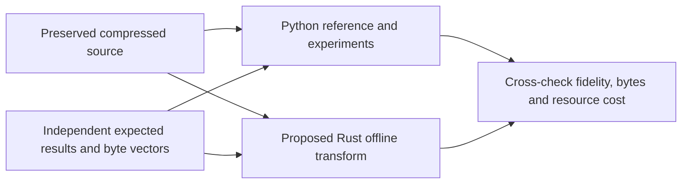

# Process-history work plan

**Status: scope review; Rust buildout awaits user approval.** This is the single
current plan. Superseded capture-owned-helper and daemon design notes live in Git
history, not parallel planning documents.

## Purpose and boundary

Understand execution on a machine from observed process CPU, RSS, identity,
topology and timing. The eventual recorder should be independent of Herdr and
terminal captures; consumers must not control acquisition. **That service is not
the next deliverable.** Production sampling, configuration, startup and restart
behavior remain unchanged.

The proposed next deliverable is a **tested, fast offline Rust transform of the
existing captured data**, retaining Python as the experiment/reference tool.
This is not a port of every Python experiment or a commitment to a final format.



Both implementations consume the same observations. Their agreement supplements,
not replaces, independent expected values and error-bound tests.

## Existing data, not more recording

The finite diagnostic was **stopped by request at 41h19m44s**, not completed at
72 hours: 1,487,845 scans, 248 closed compressed segments. The final segment
contains 5,845 of its requested 6,000 scans; its ledger says `complete=false`
but the compressed file is closed and passes its zstd checksum.

Local source is under:

```text
.recordings/2026-10-14-process-history/
  source/source-*.jsonl.zst
  source/segments.jsonl
  source/status.json
  PRESERVATION.json
```

This directory is gitignored, with private directories/files (0700/0600). The
source files occupy 2,778,751,489 bytes (~2.59 GiB), not expanded JSONL's much larger
size. All copied files were hash-checked; `PRESERVATION.json` records coverage and
SHA-256 digests. **Preservation is not full semantic validation of 41 hours.**
An earlier independent backup of the first 247 full segments (without the final
tail) is at `~/.local/state/procstats-experiments/preserved-20261016T140759Z/`.
No additional acquisition is planned for this milestone.

The [scorecard](RECORDING_RESULTS.md) still measures only the verified **8.5-hour
prefix of this same run**, source segments 0–50. A source system-CPU counter
decreases at ~8h36m while total CPU grows. The strict reference rejects that
anomaly; retain it unchanged for diagnosis.
Use declared valid windows for comparisons, not silently filtered records or an
unverified claim that the entire capture is monotone.

## Proposed first Rust milestone

One offline path:

```text
plain or zstd JSONL -> selected binary blocks -> decoded observations -> verification
```

- Port the **existing selected profile first**: CSH1 shared CPU changes, PSD1 sparse
  metadata and PST1 block envelopes. Emit blocks plus the existing Python-compatible
  manifest needed by the benchmark loader. Leave PCR1 assembly and compression in
  the existing Python/codec-CLI path; no Rust frame writer, new container, index or
  query API in this milestone.
- Preserve all observed identities, membership, names/PPID and actual wall/scan
  timestamps. CPU remains total-only: 1 ms interior precision, exact native
  per-identity block endpoints. RSS remains floored to 256 KiB. See the
  [format walkthrough](RECORDING_DATA.md) for the current wire layout and losses.
- Keep the current independent encoding boundaries for the first parity test.
  Decode by identity and sequence; do not assume matching CPU/metadata slot numbers.
- Stream input and bound block buffers. Reject unsupported integer ranges instead
  of truncating. Measure all-run identity-validation state separately; it can grow
  with churn even when block buffers are bounded.
- Use a separate offline Rust crate, not another binary target in the plugin crate.
  Reuse existing dependencies/codec CLIs; leave the plugin's `cargo run` untouched.
  Support the preserved zstd input through the existing zstd CLI, checking its exit
  status before publishing success. Plain JSONL also supports small test fixtures.
- Preserve strict source validation, including user/system components separately.
  Diagnose/reject invalid spans, rather than hiding counter decreases, inventing
  exits/zeros or claiming an exit total from the last observed sample.

### Acceptance evidence

1. **Tests first:** independently calculated byte vectors for varints, signed
   changes, CPU quotient/remainders, sparse transitions and envelopes. Assert both
   expected decoding and canonical encoding; a paired round trip is insufficient.
2. **Generated histories:** deterministic independent expected-value checks for
   tiny increments, boundaries, singleton/idle processes, gaps/returns, PID reuse,
   Unicode, name/PPID/RSS changes, backward wall clocks and independent blocks.
3. **Cross-language compatibility:** Python reads Rust output and Rust reads Python
   output. Require byte-identical selected-profile PST1 blocks on identical input
   and partitions, plus exact decoded equality. Separately compare both against
   source for exact retained metadata/native endpoints and CPU/RSS error bounds.
4. **Failure behavior:** truncated prefixes, bad lengths/counts/masks/UTF-8,
   inconsistent sections/units, expansion limits and masked component regressions.
   Test checksums separately: a valid bit mutation need not fail syntax validation.
   No success manifest for a failed transform; never overwrite source or existing
   output. Private permissions and decompressor cleanup are part of the tests.
5. **Real-data tracer bullet:** transform a declared clean source shard, independently
   decode/verify it, then compare Rust/Python on identical input. Existing plugin
   tests remain green. Do not require whole-capture anomaly handling to demonstrate
   this initial path, or mislabel a clean-shard result as a full 41-hour validation.

Report total transform CPU per recorded hour/readings, wall time, peak memory and
output bytes; compilation is excluded. Stage breakdowns are optional, not a new
instrumentation deliverable. **Codec CPU-seconds/input GiB is not end-to-end
recorder cost.** Use one worker as the baseline; distinguish memory bounds from
measured peak memory.

## Committed research priority, not first-port scope creep

**Adaptive CPU precision is a committed research priority:** revealing subtle
execution near idle is worth extra data volume. At nominal 100 ms intervals, the
current 1 ms CPU quantum gives 1 percentage-point utilization steps. Continue
Python exploration; the baseline Rust port need not wait for that policy or
freeze it. Implement selected candidates in Rust later.

Choose precision from the observed interval's CPU increment/rate, not the lifetime
counter. Test finer precision near idle and coarser precision when busy, against
uniform 1 ms and 100 us controls. Use actual elapsed time, not invented 100 ms
buckets. Thresholds/significant bits are experiments, not a chosen float format or
a claim of physical measurement accuracy.

Keep cumulative error bounded and observed native endpoints exact on valid spans.
Test interval error when precision changes: coarse remainder repayment must not
manufacture activity after a process becomes quiet. Preserve missingness and
singleton baselines. Compare low-rate error, false idle/busy, return-to-quiet timing,
bytes and CPU, not compression ratio alone.

Other candidates are a shared identity/clock table, longer baseline regions,
exact clock residuals and less redundant endpoint corrections. Hold fidelity
fixed when evaluating those representation changes. Keep Brotli-5 as a control,
not another broad codec sweep. Historical storage goals (~10 MB/day encoded,
ideally 1 MB/day compressed) remain unmet; they do not veto richer-fidelity research.

## Explicitly deferred

No new capture, daemon/service management, native sampler extraction, Linux
backend, Herdr/termplex/Strands integration, filesystem source, query UI/server,
retention/index framework or production wire-format freeze in the first milestone.
Crash-durable archive publication, production backpressure and service hardening
belong to a later recorder decision; defensive decoding and safe offline output do
not. Counter-anomaly/epoch representation is a separate decision before claiming
faithful full-span transformation.

## Scope confirmations before buildout approval

- Baseline Rust parity first, with adaptive precision following; or must adaptive
  precision be part of the first Rust milestone?
- Are PST1 blocks plus the existing Python compression path sufficient initially,
  or must Rust also own PCR1 framing/compression now?
- Is strict rejection of anomalies with clean-window verification acceptable
  initially, or must a full-capture quality/epoch policy be included first?
