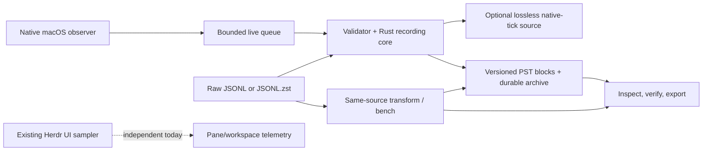

# Rust process-history recorder: implementation plan and status

**One current plan; no new design phase.** The user-approved buildout is implemented
in the existing `pane-load` binary: native capture, shared Rust validation/encoding,
archives, source transforms, inspection/export, and benchmarking. Final full-capture
validation and the independent Opus architecture/design review are still pending.
The older Python codec work remains a measured reference, not the current recorder.



The standalone recording path does not depend on Herdr or terminal capture. The UI
sampler remains separate; recording has not been wired into it.

## Implemented scope

- `pane-load recording record` samples native process CPU components and RSS at
  10 Hz by default, directly from the macOS acquisition path. CPU stays in native
  ticks with an explicit timebase. Capture context records the `mach_continuous_time`
  origin/timebase, wall anchors, run/boot identity, and non-atomic scan method.
  There is no JSONL or Python round trip in this path.
- Raw-reference output uses `recording_source: 1`, declares `cpu_unit: native_ticks`,
  and retains accepted observations, separate user/system CPU counters, RSS and
  quality information. It is lossless relative to those accepted observations.
  Existing legacy `probe_capture: 1` JSONL/`.jsonl.zst` is readable; if its header
  has no source timebase, import requires an explicit `--timebase NUM/DEN` and
  never guesses from the current host. For the known legacy source, use `125/3`.
- `adaptive` is the default binary profile. It writes PST2 blocks with PSD1 sparse
  metadata and CSH2 CPU layout version 1. Adaptive interval quantums target less
  than 12.5% relative CPU-increment error, capped at 1 ms in source ticks; Q=1
  intervals, including zero intervals, are exact. `legacy-1ms` is the PST1/CSH1
  comparison control; `fixed-100us` is another PST2/CSH2 control. All binary
  profiles keep total CPU only. RSS is floored to 256 KiB; observations and
  quality flags are retained.
- Binary archives journal private blocks atomically before frame publication.
  Defaults are Brotli-5, a 1 MiB window (window log 20), 16 MiB frame input,
  300-row/approximately 30-second blocks and a one-hour source-time frame limit.
  Roots/run directories are private; defaults cap a root at 8 GiB and reserve
  20 GiB free space. SIGTERM/normal shutdown sends the end marker and flushes the
  current block/frame. Recovery validates journals/frames; partial runs are not
  presented as complete.
- `transform`, `inspect`, and `bench` use the same Rust model and binary codecs.
  Inspect JSONL from binary is explicitly decoded/quantized: `cpu_components` is
  `null`, components are unavailable, and CPU error bounds are included.
  `--blocks-out` exports quantized PST blocks, not finer source truth. Raw-source
  JSONL export remains distinct. Bench compares profiles over the same raw source
  or benchmarks the stored profile from a binary archive/cache using shared source
  and frame geometry.
- The existing include-based Python capture shim remains supported through the
  project-library path dependency. Python and external codec CLIs are not runtime
  dependencies of the Rust recording commands.

## CLI entry points

Build before running; the foreground recorder is not a plugin startup hook:

```sh
cd ~/.vim/herdr-plugins/pane-load
cargo build --release
./target/release/pane-load recording record \
  --output .recordings --duration 10 --format binary
```

The default profile is adaptive; default frequency is 10 Hz. Main options are:

```text
record   --output ROOT [--duration SEC] [--hz N]
         [--profile adaptive|legacy-1ms|fixed-100us]
         [--format binary|jsonl-zstd]
transform --input FILE|CAPTUREROOT --output NEWROOT
          [--timebase NUM/DEN] [--profile PROFILE] [--verify]
inspect  --input ARCHIVE|RECORDROOT|CACHE [--verify] [--recover]
         [--jsonl | --blocks-out NEWPRIVATEdir]
bench    --input RAWSOURCE|ARCHIVE/CACHE
         --profiles adaptive,legacy-1ms,fixed-100us
         [--timebase NUM/DEN] [--frame-bytes N] --output DIR|FILE.jsonl
```

For example, legacy normalized-nanosecond source without a declared timebase:

```sh
./target/release/pane-load recording transform \
  --input /path/to/legacy.jsonl.zst --output /path/to/new-recording \
  --timebase 125/3 --profile adaptive --verify
```

Transform also accepts block/frame/storage-limit options; inspect verifies and
summarizes archives, source files and PST caches, can recover an archive, or export
JSONL. `--blocks-out` requires a new private directory. Bench uses 16 MiB frames
by default; cached binary input supports codec-only comparison of its stored
profile, while raw source supports profile comparisons. See the CLI's `--help` for
its exact option bounds.

## Fidelity and deployment boundaries

Raw reference observations preserve user and system components separately. Binary
CSH2 stores their total; a decoder cannot recreate the original split or recover
raw counters from quantized values. It reports the per-reading CPU error bound.
The CPU counters are observed snapshots, not utilization percentages; scans are
non-atomic and cannot guarantee seeing every short-lived process. RSS is a point
reading, not a poll-interval average.

Recording is manual and standalone. This work does not enable deployment, automount,
service installation/restart, change plugin startup, or alter UI defaults. Linux
acquisition, service packaging, UI/consumer adapters, and timeline/history UI remain
future work. In particular, there is no claim of shared sampling between the
recorder and the current UI sampler.

## Remaining closeout

The core, live capture path, and tools are feature-complete. The Rust first-shard
verification is explicitly provisional in the [results](RECORDING_RESULTS.md).
Still pending:

1. Run and verify the complete 41-hour source corpus with the final Rust code and
   hardware/run settings; publish final same-source size, fidelity, wall/CPU/RSS,
   and codec metrics in the scorecard. Do not project the historical fixed-profile
   daily size onto adaptive output.
2. Complete the Opus architecture/design review and record its outcome here and in
   the scorecard. This is closeout review, not another generic design/approval phase.

The [data guide](RECORDING_DATA.md) keeps the measured Python prototype tutorial
intact and adds the concise current Rust wire summary.
