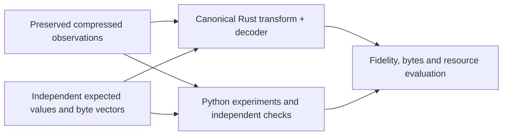
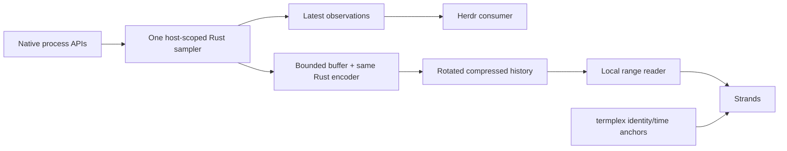

# Process-history work plan

**Scope direction: Rust becomes the canonical binary transform, including adaptive
CPU precision. The eventual product is an independent Rust daemon.** Remaining
boundaries below await final scope approval; buildout has not started. This is the
single plan; superseded proposals live in Git history.

## Immediate work and ownership

Build a tested, fast offline Rust transform of the existing captured data. Rust
owns the supported encoder, decoder and versioned format—not merely a faster copy
of a Python-defined protocol. Python remains a research tool and independent
validation/reference implementation, not a production dependency or the format
authority. Do not port every experimental Python variant.



The existing fixed-precision scheme is a useful baseline/internal tracer bullet.
**A fixed-1-ms-only port does not complete the milestone: adaptive CPU precision
is required.** Agreement between implementations supplements, not replaces,
independently calculated expectations and error-bound tests.

## Eventual daemon: design context, not abandoned scope



- Acquire readable processes once per host; CPU and RSS share a nominal 10 Hz scan.
  Use the same encoder core directly on native observations; JSONL is an offline
  input bridge, not a required live intermediate.
- Recording survives consumer disconnects and does not depend on Herdr or termplex.
  Terminal recording must never wait for telemetry. Correlation uses boot/run/process
  identity and explicit wall/monotonic clocks, not PID alone or assumed cadence.
- Bound buffers, compression backlog, disk use and retention. Publish finalized
  chunks before indexing; report availability, gaps and recorder health rather
  than inventing zero usage. Slow readers or full disks must not grow memory forever.
- A foreground daemon supervised by the OS is the eventual packaging direction;
  no custom detachment/restart system is needed now. Per-platform acquisition,
  archive recovery and consumer interfaces need their own implementation decisions.

This context guides the encoder boundary; it does not authorize deployment.
Production sampling, configuration, startup and restart behavior remain unchanged.

## Existing data, not more recording

The finite diagnostic was **stopped by request at 41h19m44s**, not completed at
72 hours: 1,487,845 scans, 248 closed compressed segments. The final segment has
5,845/6,000 scans: `complete=false` denotes its interrupted duration, not a torn
file; its zstd checksum passes.

Local source is under:

```text
.recordings/2026-10-14-process-history/
  source/source-*.jsonl.zst
  source/segments.jsonl
  source/status.json
  PRESERVATION.json
```

It is gitignored, with private directories/files (0700/0600). Source zstd files
occupy 2,778,751,489 bytes (~2.59 GiB). All copied files were hash-checked;
`PRESERVATION.json` records coverage and SHA-256 digests. Preservation alone is not
semantic validation; the separate completed Python review now verifies full
observation/representation coverage with explicit quality flags. An earlier
independent backup of the first 247
full segments, without the final tail, is at
`~/.local/state/procstats-experiments/preserved-20261016T140759Z/`.
No additional acquisition is planned for this milestone.

The [scorecard](RECORDING_RESULTS.md) now reports the **full 41-hour review** and
retains complementary sweeps on the earlier strict **8.5-hour prefix**, segments
0–50. The full review found 14 component decreases, beginning at ~8h36m, and kept
all observations with explicit quality flags. It does not claim globally monotone
counters. Canonical Rust quality/epoch handling remains an open decision.

For the requested full-span **Python review**, `recording_review.py` caches verified
fixed-1-ms/256-KiB PST1 blocks and flags original component decreases in the next
block's header, starting a new baseline without dropping scans or changing identity.
Rates across affected process intervals are unavailable, not zero or proof of
restart. These flag bytes count in compression. The strict `recording_storage.py`
reference is unchanged; this experiment does not settle the future Rust policy.
The completed cache and report are under `.recordings/review-41h-python/`.
Per-shard hashes/checkpoints make the computed cache reusable and resumable.

## Canonical Rust transform milestone

```text
plain or zstd JSONL -> versioned adaptive binary blocks -> decoded observations
                                                     -> independent verification
```

- Start from the existing CPU/metadata split and reuse PSD1 sparse metadata and
  PST1 envelopes where compatible. **Version the adaptive CPU profile explicitly**;
  do not label variable precision as old CSH1 fixed-Q data. Describe units, precision
  policy and correction semantics honestly in its header/manifest.
- Preserve all observed identities, membership, names/PPID and actual wall/scan
  timestamps. CPU remains total-only with exact native observed endpoints on valid
  spans; dynamic interior/interval bounds are part of the new contract.
- **RSS stays at 256 KiB floor precision and nominal 10 Hz cadence**, alongside CPU.
  Every readable-process observation retains an RSS value; sparse encoding omits
  unchanged quantized values, not observations. RSS is a point-in-time reading,
  not an interval average; the scan is not an atomic whole-machine snapshot.
- Use existing independent block boundaries initially. Join CPU/metadata by identity
  and sequence, not matching slot numbers. Stream input, bound block buffers, reject
  unsupported integer widths and measure all-run identity-state growth separately.
- Use a separate offline Rust crate, leaving the plugin's `cargo run` untouched.
  Reuse dependencies/codec CLIs where adequate. Check zstd subprocess completion
  before declaring success. Emit private, exclusive output with benchmark-loader
  provenance/manifest support; never overwrite source or prior output.
- Validate user/system components separately before summing. Diagnose/reject invalid
  spans unless an explicit quality/epoch policy has been approved. Never hide
  component decreases, fabricate missing values or claim exact process exit totals.

### Adaptive CPU contract and calibration

Reveal subtle activity near idle even at increased volume. The old 1 ms quantum
at nominal 100 ms intervals gives 1 percentage-point utilization steps. Finer
CPU precision changes those steps, not the acquisition cadence.

Choose precision from the **observed interval's CPU increment/rate**, not lifetime
CPU. Compare a few precision bands/significant bits with fixed 1 ms and 100 us
controls. Fine-near-idle/coarse-when-busy is required; exact bands, minimum precision
and wire representation must be specified and tested before acceptance, not assumed
from an analogy to IEEE floating point. Use actual elapsed time; never fill gaps
with invented 100 ms buckets. A singleton has no measured interval rate.

Keep cumulative error bounded without repeated-rounding drift, and observed native
endpoints exact on valid spans. Specify/test **both point and interval error** when
precision changes: coarse remainder repayment must not manufacture CPU activity
after a process becomes quiet. Preserve missingness and singleton baselines.
Assess low-rate error, false idle/busy, return-to-quiet timing, volume and CPU.

### Acceptance evidence

1. **Tests first:** independent byte vectors and expected values for units/varints,
   signed changes, sparse state, adaptive precision transitions/corrections and
   envelopes. Assert decoding and encoding separately, not only paired round trips.
2. **Generated histories:** tiny increments, zero/idle/singleton cases, boundaries,
   gaps/returns, PID reuse, Unicode/name/PPID/RSS changes, backward wall clocks,
   independent blocks and busy-to-quiet transitions. Check total drift and interval
   error against a simple independent model, including each declared precision band.
3. **Cross-language checks:** retain byte compatibility tests for unchanged sections
   and fixed-profile controls where implemented. The new Rust adaptive profile is
   not required to match the old fixed-Q CPU bytes. Its versioned vectors and an
   independent Python reader/model verify exact retained metadata/native endpoints,
   declared error bounds and the logical 10 Hz RSS observations.
4. **Failures:** truncated prefixes, invalid flags/lengths/counts/UTF-8, inconsistent
   units/sections, overflow/expansion limits and masked component regressions. Check
   integrity separately from syntax. Failed transforms publish no success manifest;
   test private permissions, exclusive output and decompressor cleanup.
5. **Real-data tracer bullet:** transform a declared clean shard, independently
   decode/verify it and compare fixed/adaptive fidelity and cost on identical data.
   Do not mislabel a clean-shard test as full 41-hour validation. Existing production
   plugin tests stay green.

Report total transform CPU per recorded hour/readings, wall time, peak memory and
output bytes, excluding compilation. Stage breakdowns are optional. Codec
CPU-seconds/input GiB is not end-to-end recorder cost. Use one worker as the
baseline; distinguish bounded buffers from measured peak memory/state growth.

## Further research and delivery boundaries

Keep Python for representation experiments; port selected improvements into the
canonical Rust implementation. Candidates include shared identity/clocks, longer
baseline regions, exact clock residuals and less redundant endpoint corrections.
Hold fidelity fixed for those comparisons. Keep Brotli-5 as a control rather than
running another broad codec sweep. Historical storage goals (~10 MB/day encoded,
ideally 1 MB/day compressed) remain unmet; they do not veto richer-fidelity research.
The [format guide](RECORDING_DATA.md) and scorecard describe the old measured
prototype, not an already implemented adaptive Rust format.

No new capture, daemon deployment, native sampler extraction, Linux backend,
Herdr/termplex/Strands integration, filesystem source, query UI/server, retention
framework or production format freeze in this transform milestone. Daemon design
context stays above; its service lifecycle, crash recovery and backpressure are
later delivery work. Defensive decoding and safe offline output are not deferred.

## Remaining scope confirmations before buildout approval

- Are Rust blocks plus the existing Python PCR1/compression benchmark path sufficient
  temporarily, or should Rust own PCR1 framing/compression in this milestone too?
- Is strict rejection of anomalies with clean-window verification acceptable first,
  or must a full-capture quality/epoch policy be included now?
