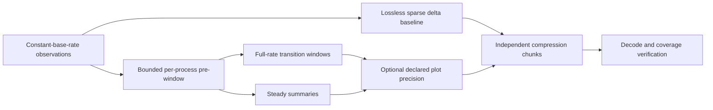

# Process-history recording experiments

Measured 2026-10-08 and 2026-10-14; updated 2026-10-14. Experimental Python
codecs/policies around the existing Rust/macOS acquisition code. **These
experiments do not modify production sampling, Herdr reporting, configuration or
startup behavior.**

## Storage gate

Aim for roughly **10 MB/day encoded and ideally 1 MB/day compressed**, with
constant-base-rate observation and higher retained detail around important
transitions. Neither the live storage gate nor a production recording format has
been established. Synthetic compressibility is not evidence that this host meets
the gate. There is no background recording service installed by these experiments.



Observation and retention are separate. Detection uses the original observations,
not rounded archive values. Adaptive summaries are intentionally lossy outside
transition windows. Precision variants declare units and their error bounds.

## Same-capture live comparison

600 samples at a requested 10 Hz, roughly one minute, 1,007–1,168 readable
processes. One controlled worker: 30-second CPU plateau, return to quiet,
one-second CPU pulse, and a 20 MiB RSS allocation ramp. Lower-rate experiments
subsample the same capture; they are not separate acquisition measurements.

60-second independently decodable chunks; projected daily figures below repeat
this short workload and its checkpoint overhead. **Not an observed daily total.**
All compression/layout variants are checked after decompression.

| Encoding | Encoded MiB/day | Compressed MiB/day (Brotli-4) |
| --- | ---: | ---: |
| Full tuple snapshots | 67,081 | 1,854 |
| Lossless sparse masks + varints | 1,271 | 1,019 |
| Sparse with bounded plot precision | 615 | **246** |
| Adaptive windows + sparse selected samples | 1,372 | 602 |
| Adaptive + bounded plot precision | 1,279 | 379 |

The 246 MiB/day variant also measured 247 MiB/day with zstd-3. No useful codec
winner is established here: representation and retention dominate that difference.

Plot-precision variant:

- cumulative CPU counters floored to 1 ms (counter error less than 1 ms);
- RSS floored to 64 KiB (error less than 64 KiB);
- wall/start timestamps floored to 1 ms, scan-end timestamps rounded upward;
  scan envelopes remain conservative;
- adaptive steady summaries, where used: 60-second maximum span, CPU endpoints
  at 10 ms precision, RSS endpoints at 256 KiB with outward-rounded RSS extrema.

These are explicitly bounded approximations, not exact counters/timestamps.
PID/start identity is never rounded. Default lossless variants preserve every
integer. The precision policy is an experiment, not a recommended final setting.

Native scan averaged **8.78 ms**, max **405.76 ms**; tuple encoding averaged
**0.50 ms**. There were **25 scan deadline overruns**. The collector catches up
on its nominal schedule: averaged 10 Hz is not a guarantee of evenly spaced or
exhaustive observations. Historical truth must include scan bounds, availability
and acquisition gaps. Unreadable/raced reads remain missing observations, not exits.

## What is costing space?

This was not a quiet topology: **4,816 distinct PIDs**, including **3,770 first
observed after the initial frame**, within one minute. None changed its start
identity in this capture. Of those new PIDs, 1,662 were `sleep` and 1,005 `bash`:
roughly 71% of observed new processes came from those two names.

Lossless sparse raw-byte breakdown for that minute:

| Contributor | Bytes | Approximate share |
| --- | ---: | ---: |
| User + system CPU increments | 526,452 | 57% |
| Slot identifiers + field masks | 193,301 | 21% |
| New identities + initial values | 155,212 | 17% |
| RSS changes | 40,982 | 4% |
| Timing + record counts | 8,971 | 1% |
| Name / existing-parent changes | 925 | <1% |

There were about 142 user-counter and 143 system-counter changes per base tick;
RSS changed for about 22 processes per tick. Compression operates on all of these
contributors together, so these shares are not compressed-byte attribution.

**Static tree serialization is not the primary remaining problem.** New-process
churn still matters, but tiny, frequent cumulative-counter changes dominate the
raw delta stream. The first adaptive policy also reopened windows repeatedly as
CPU rates fluctuated; adaptive encoding was not automatically smaller than the
lossless baseline. Startup windows and per-process summary overhead are additional
costs, not yet optimized away.

## Synthetic control

A deliberately simple 1,000-process mostly-idle host with only a few active
processes and predictable timestamps reached **1.70 MiB/day compressed at 10 Hz**
using lossless sparse varints and zstd-1 (45.81 MiB/day encoded). The 1 Hz version
was 1.72 MiB/day compressed. This demonstrates that unchanged processes need not
multiply storage with sample frequency.

It has highly repetitive names, start metadata, timing and counters. The simple
adaptive policy/encoding was worse, around 10–12 MiB/day compressed after sparse
sample packing. Neither result represents realistic whole-machine performance.

## CPU/time columns and accounting-preserving retention

Measured 2026-10-09 against the **same** private one-minute capture. New offline
`recording_cpu_columns.py` / `recording_cpu_matrix.py` experiments; no production
changes. This isolates **CPU/time series only**, excluding PID/start/name/parent,
RSS, availability events, wall-clock correlation and seek indexes. Even these
component projections remain far above the storage gate.

```text
native cumulative CPU C[i]          observed monotonic time T[i]
           |                                   |
     retain first/last + selected grid points (all observed identities kept)
           |                                   |
     cumulative quotient/remainder, NOT rounded individual intervals
           |                                   |
     CPU delta column                   actual elapsed-time column
           +----------------------+----------------+
                                  |
                    independent per-series baseline + endpoint remainders
                                  |
                         compressor -> decode -> accounting checks
```

The input normalized user/system counters are individually restored to native
Mach counts with an explicitly supplied **125/3 ns** timebase. Every restored
counter is checked by converting back to the captured integer. Their **native
sum** is used as total CPU; no separate user/system arrays in this experiment.
Native tick counts, not decimal nanosecond representations, are the lossless
baseline. This timebase is machine-specific, not a universal macOS constant.

For a CPU quantum `Q`, store `q[i] = C[i] // Q`, then differences of `q[i]`.
Preserve first/final remainders `r[i] = C[i] % Q`:

```text
Q * sum(delta_q) + r_final - r_first = C_final - C_first
C_first = Q * q_first + r_first
C_final = Q * q_final + r_final
```

Raw-native mode preserves every retained CPU counter exactly. Coarse modes have
intermediate counter error **less than Q**, but exact first/final counter values
and exact observed CPU increments. Endpoint corrections do **not** make every
intermediate interval exact. Rounding each CPU increment independently would
lose repeated sub-quantum usage and is deliberately not used. Time is similarly
quantized cumulatively to 1 ms, with exact endpoint time remainders.

Both 1 Hz and 10 Hz **retention** keep every observed process identity, including
single-observation identities, and first/last available readings. All variants
with endpoint corrections preserve the same **6,671,219,228 native CPU ticks**
(~277.967 CPU-seconds) of observed first-to-last increments. This excludes CPU
before each first read from the increment sum (its cumulative baseline is still
saved), and cannot recover unobserved exit tails or never-observed processes.
The 1 Hz mode is not an acquisition-at-1-Hz experiment: short-life endpoints may
still be 100 ms apart. No process churn is silently removed to improve storage.

Projection duration is **59.904674875 s**, measured first-to-last scan start;
this convention differs slightly from earlier nominal-one-minute projections.
The capture has frame scan-start/end markers, **not per-process read timestamps**:
encoding-time error bounds do not imply corresponding utilization accuracy.
Batch scan skew and kernel accounting uncertainty remain separate limitations.

### Compressor/layout matrix

96 binary variants: eight layouts x uvarints/fixed-u64 x three CPU precisions x
two retention rates. Each is evaluated with zstd-1, zstd-3, Brotli-4 and gzip-6
(**384 compression cases**); exact decompression, cumulative arrays and endpoint
accounting are independently checked. Validation also works under `python -O`.

Best compressed result per layout, **1 ms CPU point precision**, including exact
CPU/time endpoint remainders; MiB/day projections, **not measured daily totals**:

| Layout | 1 Hz retained | 10 Hz retained |
| --- | ---: | ---: |
| Cumulative CPU + elapsed time, interleaved | 173.05 | 600.29 |
| Cumulative CPU column + elapsed-time column | 105.03 | 185.16 |
| CPU/time deltas, interleaved | 92.67 | 155.51 |
| **CPU/time delta columns** | **80.22** | **123.26** |
| CPU delta column + period-change runs | 83.67 | 144.20 |
| CPU delta column + period-grouped start-index lists | 83.92 | 143.02 |
| CPU/time both run-coded | 95.02 | 190.00 |
| CPU run-coded + elapsed-time column | 91.85 | 168.83 |

Winning layout at every tested precision was plain delta columns with uvarints:

| CPU point precision | Encoded MiB/day, 1 Hz | Compressed MiB/day, 1 Hz | Encoded MiB/day, 10 Hz | Compressed MiB/day, 10 Hz |
| --- | ---: | ---: | ---: | ---: |
| Raw native tick (~41.7 ns/unit) | 443.66 | 123.39 | 2034.93 | 358.18 |
| 1 ms + exact endpoint remainders | 410.90 | 80.22 | 1886.93 | 123.26 |
| 10 ms + exact endpoint remainders | 416.62 | 68.18 | 1893.15 | 92.29 |

The 1 Hz column winners used gzip-6. At 10 Hz, raw-native and 10 ms used Brotli-4;
1 ms used gzip-6. Coarsening points is not guaranteed to reduce **encoded** bytes:
larger exact remainders can outweigh smaller deltas. Run coding reduced some raw
sizes but compressed worse; optimize the whole pipeline, not only precompression.

Column ordering helps. Period-change indexes did **not** win on this live input:
actual elapsed intervals vary with scheduler/scan jitter even at fixed nominal
cadence. A frequency policy is not an exact elapsed-time clock. A future shared
clock experiment should separate nominal period changes from actual timing
corrections rather than silently replacing observations with scheduled times.

Reproduce (raw capture remains private; only summary results belong in Git):

```sh
python3 recording_cpu_matrix.py --input /path/to/private/capture.jsonl \
  --mach-timebase 125 3 --rates 1 10 --cpu-ms 0 1 10 --time-ms 1
```

Without `--mach-timebase`, captured CPU ns integers are treated as the counter
units instead. Exact inverse restoration rejects noninjective timebases. Coarse
time units that collapse distinct retained points are explicitly rejected.
`--endpoints bounded` deliberately omits endpoint corrections and is **not** an
exact native CPU-total representation; it must not be compared as equal fidelity.

### Acquisition parameters for the next backend experiment

- Linux `/proc/<pid>/stat` fields 14/15 export user/system in
  `sysconf(_SC_CLK_TCK)` ticks; commonly 100 Hz means 10 ms per tick. This is not
  `CONFIG_HZ` and not proof of 10 ms internal accounting. Children are separate;
  process-wide totals should not be added again to their per-thread totals.
- **Linux need not use that coarse export for total CPU.**
  [`clock_getcpuclockid(pid, &id)` followed by `clock_gettime(id, &ts)`](https://man7.org/linux/man-pages/man3/clock_getcpuclockid.3.html)
  exposes a process CPU-time clock in seconds/nanoseconds. Linux's scheduler CPU
  clock is process/thread-group runtime, not `/proc` USER_HZ ticks. Query
  `clock_getres`; nanosecond units/advertised resolution are not nanosecond
  measurement accuracy. Use `/proc` for identity/topology/RSS, and benchmark the
  additional CPU-clock path on Linux before adopting it (no Linux backend added).
- macOS existing `proc_listpids` + `proc_pidinfo(PROC_PIDTASKINFO)` provides
  `pti_total_user` and `pti_total_system` in Mach absolute-time units. Query
  `mach_timebase_info`, don't assume ns. Apple's
  [`fill_taskprocinfo`](https://github.com/apple-oss-distributions/xnu/blob/main/osfmk/kern/bsd_kern.c)
  uses `recount_task_times`; live-thread values subtract terminated-thread time
  from those totals, so **total** values retain terminated-thread CPU.
- A separate C diagnostic on this Apple Silicon host verified the 125/3 timebase:
  4,736,913 native CPU ticks became 197,371,375 ns, versus 197,374,000 ns from
  `getrusage`, during a 200 ms wall-time burn. The few microseconds of difference
  include the differing read boundaries; this checks units, not nanosecond accuracy.
- Proposed acquisition should bracket each CPU read with actual monotonic clock
  readings; never compute utilization from the requested sampling period alone.
  Record clock basis/suspend semantics, uncertainty and missing observations.
  Native CPU units and time units are separate chunk-header parameters.

Next useful format experiment: **shared observation clock / coverage plane**, CPU
columns and per-series baselines, sparse nonzero CPU positions or runs selected by
measured cost, separate topology events. Preserve exact native deltas unless
coarser point precision and endpoint-only exactness are explicitly chosen. This
matrix does not establish a final format, full-machine budget, or adaptive policy.

## Narrowed real-data replay: shared clock and bounded CPU noise

The earlier 384 compression cases **already used real machine activity**, not
synthetic rows. They replayed the same host-wide minute with one controlled
worker. Only the separate ~1.7 MiB/day mostly-idle control was synthetic.

This follow-up reuses that identical file: SHA-256
`25dff4cc19fdfb078c759a53a2a7f1c822b2929fe4ab66c3a9bb0396d53f6399`;
**631,155 observations, 4,816 identities, 59.904674875 seconds, nominal 10 Hz**.
No new acquisition flukes are introduced between candidates. It is still one
short workload, not a representative day or a held-out validation corpus.

```text
same real capture
  +-- exact topology / RSS / availability / wall+scan timing sidecar
  +-- shared CPU clock -> sparse changes OR bounded cumulative-CPU curve
                          -> optional cumulative quantization
  -> independently compressed 10s / 60s frames -> decode + exact loss audit
```

`recording_cpu_focus.py` narrows the sweep to nine representations, two frame
sizes and zstd-3/Brotli-4/gzip-6: **54 aggregate comparisons**. The new shared-clock
codec includes PID/start identities and coverage runs. The sidecar keeps original
names, parents, RSS and observation availability, including single-point PIDs;
RSS uses its exact common 4,096-byte unit, not rounded memory values. CPU is
**total user+system**, not the separate components. These are broader payloads
than the prior CPU/time-only table; do not directly compare their daily rates.
Boot/run identifiers, a persistent seek index and recovery machinery remain
outside this experimental payload. Files and runtime configuration are unchanged.

The noise heuristic simplifies the **cumulative CPU curve**, not instantaneous
CPU percentages. Retained knots are original observations; a straight line may
replace intervening samples only when every original counter is within the
specified absolute CPU-time tolerance. Integer cross-products and exact rational
checks enforce the bound. First/last counters remain exact, gaps split runs, and
segments are capped at 10 seconds unless an adjacent acquisition interval itself
exceeds that. A 100 ms CPU-error allowance can hide meaningful short bursts;
it is an intentionally aggressive comparison, not a recommended default.

This is an **offline retrospective** simplifier, not a bounded-memory production
policy or recurring-pattern classifier. Interpolated values are estimates of
captured counters, not recovered truth between polls. Kernel accounting latency
and non-atomic frame timing remain acquisition uncertainties. All compressors
already exploit repeated byte patterns; no speculative periodic predictor added.

### Results after 60-second independent compression frames

Best compressed codec for each row; CPU endpoint totals exact in every case.
The CPU curve error is bounded at all original observations. Projections repeat
this minute, **not measured daily totals**.

| Representation | Retained CPU points | Maximum CPU-counter error | Payload MiB/day | Worker maximum 1s CPU-rate error, percentage points |
| --- | ---: | ---: | ---: | ---: |
| Shared clock, sparse native changes | 631,155 | 0 | 525.24 | 0 |
| Sparse changes, 1 ms cumulative quantum | 631,155 | <1 ms | **258.00** | 0.092 |
| Sparse changes, 10 ms cumulative quantum | 631,155 | <10 ms | **230.26** | 0.971 |
| Exact piecewise-linear CPU curve | 135,821 | 0 | 517.12 | 0 |
| Curve tolerance 1 ms | 28,411 | <=1 ms | 291.10 | 0.113 |
| Curve tolerance 10 ms | 16,631 | <=10 ms | 239.87 | 1.291 |
| Curve tolerance 100 ms | 13,465 | <=100 ms | 223.96 | 9.616 |
| Combined 0.5 ms curve + 0.5 ms quantum | 34,755 | <1 ms combined | 259.27 | 0.074 |
| Combined 5 ms curve + 5 ms quantum | 19,159 | <10 ms combined | 231.60 | 0.960 |

The first four rows used Brotli-4; the other rows used zstd-3. A 10-second frame
was consistently much larger: e.g. **436.53 vs 230.26 MiB/day** for sparse 10 ms.
Curve simplification removed **97.4% of points** at 10 ms error but did not beat
simple 10 ms cumulative quantization. Fewer stored points are not automatically
fewer compressed bytes: the remaining full-precision knots and positions can be
less repetitive. Combining thinning and quantization nearly matched the simpler
scheme but did not establish a size win.

The exact non-CPU sidecar alone compressed to **138.12 MiB/day with Brotli-4**
(or 141.90 with zstd-3) at 60s framing. This is a floor **for the tested sidecar
encoding**, not an information-theoretic lower bound. CPU-only sparse 10 ms was
104.35 MiB/day and curve 100 ms 97.68 MiB/day under their winning codecs.
Component sizes are not additive: joint compression shares patterns. Optimizing
CPU alone cannot meet the whole-recorder gate while leaving this sidecar intact.

The one-second error figures audit the controlled worker across the **whole
capture, including compression-frame boundaries**. They are not all-process
maxima. All-process maxima at adjacent observed intervals were much larger:
24.68 percentage points for sparse 1 ms, 232.62 for sparse 10 ms, 399.42 for curve
10 ms and 1,983.18 for curve 100 ms. Very short catch-up intervals amplify a
small counter error when differentiated. Exact CPU volume does not promise
faithful short-window utilization. An absent eligible audit window is `null`,
not zero. Per-process counter error <=epsilon implies interval CPU-time error
<=2*epsilon, not an equally small relative utilization error.

**Next narrowed questions:** compare compact lifecycle/metadata and RSS histories;
protect coarse-window extrema before choosing more aggressive noise suppression;
then test longer ordinary-activity captures for cross-minute repetition and
held-out workloads. Do not choose a format because it discards many points or
fits a short controlled capture. Native sampling and production reporting stay
untouched. The storage gate remains unmet, including encoded-size targets.

Reproduce with installed zstd/Brotli CLIs (gzip is stdlib):

```sh
python3 recording_cpu_focus.py --input /path/to/private/capture.jsonl --frames 10 60
```

This driver currently requires the supplied capture's verified Mach timebase
125/3 and its normalized-ns input schema; it is not a generic Linux acquisition
benchmark. Raw captures stay private; only aggregate measurements belong in Git.

## Ten-minute ordinary-activity replay: RSS, churn and compressor windows

A **different, longer real capture**, acquired 2026-10-14: 6,000 scans at nominal
10 Hz, **599.900651167 seconds** first-to-last scan start, **6,334,450 process
observations** and **19,963 identities**. Concurrent readable processes:
1,039–1,118. No controlled workload; normal active development, including other
builds/tools, continued. Compression benchmarks began only after capture ended.
The approximately 466 MiB JSONL capture stays private. SHA-256:
`033d51988cc605a51d57a8d893e0bed71fbe3cb7747849790466e5daa95809b2`.
This is not a quiet/held-out workload or a measured daily recording. Do not infer
format gains by comparing its daily projection directly with the older minute.

Native scan mean **3.80 ms**, max **46.73 ms**; tuple encoding mean **0.37 ms**.
The capture-only probe streams directly to an exclusive mode-0600 file rather
than holding the entire capture in RAM. SIGTERM preserves the private partial
capture, reports incomplete coverage, exits 143 and reaps the native child.

```text
same captured readings
  -> independent ~30s encoding blocks: CPU + metadata/RSS
  -> group whole blocks into 30 / 120 / 600s compression frames
  -> zstd or Brotli: level and match-window limits varied independently
  -> decompress, verify bytes, block hashes, counts and source endpoints
```

All variants keep every observed identity and observation. CPU is **total
user+system**, cumulative 1 ms precision with exact native CPU endpoints for each
identity in each encoding block, using this host's Mach timebase 125/3. Intermediate
CPU counters underestimate by less than 1 ms. User/system split is not retained.
All sequence, wall and scan bounds remain exact; scan markers are **not per-process
read timestamps**. The complete input is validated for component resets before
encoding. Names, PPID changes and missing/return coverage are lossless. Missing
is not an exit, and never-observed processes/exit tails cannot be recovered.

### How much structure churn?

- Initial identities **1,051**; subsequently first-observed **18,912**:
  approximately **1,892/minute**. No observed PID reuse.
- **15,495 identities (77.6%) appeared in only one scan**. This is observed
  coverage, not proof their entire lifetimes lasted under 100 ms.
- Of newly observed identities, **90.2%** were initially named `sleep` or `bash`.
- Existing identities changed PPID **13** times and name **465** times.
  Most tree churn was new/vanishing children, not existing nodes moving around.
- **18,917** transitions to absence; no same-identity returns. These are not
  authenticated exit events. Polling misses some short-lived processes entirely.

The existing `PSD1` format already delta-encodes field changes and availability.
The alternative `PSS1` orders identities by start time, delta-codes start times and
PIDs, dictionaries names, run-codes observation coverage, and separates sparse
name/PPID/RSS update positions and signed value deltas. Every block has a baseline.
**It reduced broader encoded bytes 12.4%, but did not consistently improve final
compressed size.** With exact RSS, Brotli-11 preferred existing masks (105.78 vs
107.38 MiB/day); zstd-9 slightly preferred columns (134.04 vs 135.33). No new
structural format is selected. Generic compression already exploits much of this
repetition; shorter pre-compression streams are not automatically better.

### RSS precision, holding CPU/coverage/timing fixed

All RSS values were multiples of 4,096 bytes, so that common unit is lossless
here; it is not a claim about hardware page size. Fixed schemes floor **absolute RSS**, not individual RSS differences: no drift
accumulates. Relative10 keeps the top ten significant page-count bits, with
relative underestimate <1/512 (~0.1953%); it rejects non-page-aligned input rather
than violating that bound. Both increases and decreases are preserved subject to
the declared quantization.

Broader CPU+metadata payload, **600s frames, Brotli-11, window limit log 24**:

| RSS scheme | Masks MiB/day | Columns MiB/day | Largest point underestimate | RSS transitions |
| --- | ---: | ---: | ---: | ---: |
| Exact 4 KiB units | 105.78 | 107.38 | 0 | 49,231 |
| Floor to 64 KiB | **97.85** | 101.44 | 60 KiB | 30,943 |
| Floor to 256 KiB | **92.29** | 96.26 | 248 KiB | 15,385 |
| Floor to 1 MiB | not tested | 93.11 | 1,008 KiB | 7,728 |
| Relative10 | not tested | 103.34 | 2,032 KiB (0.192%) | 28,817 |

Thus 64/256 KiB saved **7.5% / 12.8%** of the complete tested payload versus
exact RSS in the same mask layout. Relative precision helped less because small
processes remain near native page precision. Its larger processes can lose MiB
of absolute detail despite a small relative error. Measured worst per-identity
peak underestimates: **48 KiB / 240 KiB / 1,008 KiB / 1,200 KiB**, respectively.
No coarse-window extrema protection is implemented here. Small spikes can vanish,
and fixed schemes can round a small nonzero RSS to zero (100% relative loss).
These are explicit fidelity choices, not recommendations or evidence that future
RCA questions will remain answerable. RSS transitions count changes between
successive successful readings of each identity, not just consecutive scan IDs.

### Codec level, match window and compression-frame duration

Using zstd **1.5.7** and Brotli **1.2.0**, on the **same columns/exact-RSS input**:
zstd levels 1/3/9/15/19; Brotli qualities
4/6/9/11; independent compression frames 30/120/600s. Balanced levels use match
window logs 16/20/24; high levels were first compared at log 24, then 19/11 also
at 16/20 for 600s. This is a narrowed staged comparison, not a full Cartesian sweep.

| Codec/level, configured window log 24 | 30s MiB/day | 120s MiB/day | 600s MiB/day |
| --- | ---: | ---: | ---: |
| zstd-9 | 202.08 | 150.96 | 134.04 |
| zstd-19 | 191.62 | 141.31 | 125.88 |
| Brotli-9 | 193.36 | 140.60 | 125.78 |
| Brotli-11 | 172.99 | 121.98 | **107.38** |

At 600s, increasing window log **16 -> 20 -> 24** yielded:
- zstd-19: **194.10 -> 126.40 -> 125.88 MiB/day**;
- Brotli-11: **173.80 -> 107.78 -> 107.38 MiB/day**.

Most window benefit was reached by roughly **1 MiB**, not the 16 MiB configured
limit. These are **requested limits**, not measured allocations: zstd can clamp
the actual window to known input size; Brotli windows are `2^log - 16` bytes.
The largest entire compression-frame input was only **2.60 MB**, so this cannot
evaluate long-distance matching across tens of MiB. No nonstandard Brotli
large-window extension or trained dictionary was used.

Brotli-11 used **4.52 child CPU-seconds per 599.9s** (~0.75% of one core) versus
zstd-19 **0.67s** (~0.11%). Compression alone looks affordable at this measured
rate. These figures exclude acquisition and Python transforms/validation; the
single-case Python prepare plus audit took ~113s wall time. They do **not**
establish production CPU/memory efficiency. At 600s framing, decompression to
encoded bytes took ~16 ms zstd / ~23 ms Brotli including process startup. That
is **not full semantic decoding, PID lookup or query latency**. Peak RSS of the
compressors/decoders is not yet measured. A seek must decompress the entire
compression frame; independently encoded internal blocks do not remove that cost.

All quoted rates include encoding envelopes, CPU and metadata baselines, observed
coverage, scan/wall timing, and codec frame headers. Artifact manifests, persistent
host/boot catalogs, seek indexes, retention and filesystem overhead remain outside
these payload measurements: **this is not a complete archive budget**. Component
sizes are not additive. Even ~92 MiB/day compressed remains roughly two orders of
magnitude above the ideal, and encoded size remains far above 10 MB/day. RSS
precision and higher compressor levels help, but do not solve the gate.

Reproduce from this directory (paths are private; output directories/files refuse
overwrites):

```sh
python3 recording-probe.py --samples 6000 --interval .1 --capture-out /private/capture.jsonl
python3 recording_storage.py --input /private/capture.jsonl \
  --output-dir /private/mask-256k --layout mask --rss 256k
python3 recording_compression.py --input-dir /private/mask-256k \
  --frames 30 120 600 --output /private/compression.jsonl
# Strong levels; window 24. Adjust levels/windows explicitly for follow-up comparisons.
python3 recording_compression.py --input-dir /private/mask-256k \
  --finalists --output /private/strong.jsonl
```

Preparation buffers bounded-size blocks but its exact per-identity churn/reset
and peak audits grow with distinct identities. Compression comparison holds the
prepared encoded blocks, not the raw capture. Neither is a nonstop production
implementation. Next validate hours of quiet/bursty/high-churn and held-out
activity, assess timing-plane precision and per-process/lifecycle baselines, and
protect meaningful extrema before changing retention. Do not widen compressor
sweeps or drop churn to manufacture a passing budget.

## Verification and limits

- Latest `make test`: 46 Rust tests in the current working tree, **111 experimental
  Python tests**, fmt/clippy. These experimental changes do not edit production
  Rust; its additional tests came from concurrent unrelated work.
  Python tests also pass under `python -O`; real capture SIGTERM/reaping smoke passes.
  Historical earlier validation: 33 Rust and 79 Python tests.
  The existing wall-time-bounded busy-self test failed once while compression ran
  concurrently; isolated/full serial reruns passed. Its contention sensitivity
  was not addressed by changing production code or weakening the test.
- New CPU column/matrix tests also pass with `python -O`: accounting validation
  is explicit, not stripped-out assertions. Grouped singleton series, component
  resets hidden by total growth, size limits and malformed run/index data are covered.
- Exact sparse round-trips, independent chunks, PID reuse, missing/reappearing
  observations, metadata/counter changes, wall steps and malformed data.
- Full-rate two-second pre/post windows at both ends of a sustained plateau,
  one-sample pulses, slow RSS ramps, neighbor isolation and complete coverage.
- Rational threshold comparisons, strictly increasing acquisition time/sequence,
  explicit per-process buffer cap; emitted full samples leave the ring.
- Summaries split at compression boundaries using original observations. Exact
  per-identity chunk coverage is tested. Packing is offline, not live publication.
- Precision error bounds, unchanged identities, conservative scan envelopes,
  effective-unit reporting, private exclusive capture creation and replay.
- Manual SIGTERM smoke: native sampler and controlled workload both reaped;
  private temporary raw files removed.

The replay harness holds a capture/results in memory to compare encodings; only
its adaptive policy is streaming/bounded. This is not a measured low-memory
production implementation. Index/file-system/retention overhead, Linux and
long-duration behavior remain unmeasured. Polling can miss entire short lifetimes.

## Repeat

```sh
# Defaults: private temporary raw data, constant nominal 10 Hz, 60-second run.
python3 recording_experiment.py --workload --rates 10 --summary-seconds 60 \
  --summary-cpu-ms 10 --summary-rss-kib 256 \
  --precision-cpu-ms 1 --precision-rss-kib 64 --precision-time-us 1000

# Deterministic control, no native acquisition or workload process.
python3 recording_experiment.py --synthetic --seconds 60 --hz 10
```

Run from this directory; live acquisition requires macOS, cached Cargo dependencies,
zstd and brotli. `--capture-out PATH` explicitly preserves a new mode-0600 diagnostic
capture; it refuses overwrites. `--input PATH` replays it without sampling or
launching the workload. Delete explicitly retained captures when no longer needed.

## Next narrow experiments

1. Measure CPU counter precision / predictive counter coding separately on the
   same captured input; do not combine every representation choice at once.
2. Reduce startup and stable-summary overhead; avoid dense retention merely
   because an already-running process is first observed.
3. Test compact short-lifetime records and recurring low-cost process patterns,
   keeping full identities in the retrospective ring so significant changes can
   retain their surrounding detail. Any grouped archive must state what it omits.
4. Separate checkpoint cadence from compression-frame cadence and measure longer
   runs; one-minute startup/checkpoint extrapolation cannot establish a daily budget.

No daemonization or Herdr integration work is justified by the storage results yet.
