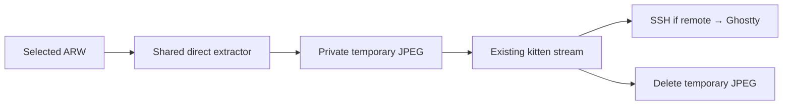

# Selected-file Sony ARW previews in lf

**Superseded for lf:** `jpg-preview/` now handles JPEG, PNG, and embedded ARW
previews entirely in Rust. This records the original Perl implementation; the
Perl helper remains only for Yazi. See `jpg-preview/README.md` for current usage.

## Verified findings

- Existing implementation: `.config/yazi/plugins/raw-thumb.yazi/main.lua:8`.
  Introduced July 9, 2026 (`f223cd3`); direct Sony extraction added July 20
  (`6301205`), then macOS `sips` moved to last fallback (`3678fdc`).
- It extracts **JPEGs, not JSON**. A small Perl parser reads classic TIFF IFD0
  tags `0x0201` / `0x0202` (JPEG offset/length), seeks to that range, and copies
  it. It does not demosaic RAW sensor data or scan the entire file.
- Yazi registers this plugin as both preloader and previewer
  (`.config/yazi/yazi.toml:10`). Its plugin creates cached previews with
  `ya.file_cache` / `ya.image_precache`. [Yazi documents](https://yazi-rs.github.io/docs/plugins/overview/#preloader)
  concurrent preloading of matching files **on the page**, not indiscriminate
  decoding of the entire directory. This supports the recollection of eager
  background work, but not the stronger whole-directory decoding claim.
  Ordinary directory listing/metadata work is separate and also exists in lf.
- Current Yazi fallback order: direct extraction → optional ExifTool → Yazi
  ImageMagick → macOS `sips`. ExifTool is absent on the NAS; Perl is installed.
- `bat-lf-previewer:38` already streams selected images through `kitten`, skips
  image preloads, and disables lf's output cache so selections redraw.
  ARWs currently enter this branch as `image/tiff`; direct kitten decoding fails.

### Fresh NAS check

Ran the **existing parser unchanged** against
`/run/media/slu/cfe4_512/DCIM/10060815/MD503051.ARW`:

| Measurement | Result |
|---|---:|
| RAW file | 67,645,440 bytes |
| Extracted JPEG | 214,428 bytes, 1616×1080 |
| Five extraction runs | 3.93 / 2.93 / 2.73 / 2.71 / 3.28 ms |
| Median extraction | 2.93 ms |
| kitten JPEG encoding to `/dev/null` | 39.58 ms, successful |

These are warm backend timings, **not** cold-storage or end-to-end display
latency. The JPEG is about 0.32% of the RAW's size. Temporary benchmark files
were removed. Recovered July history also reported 5–6 ms extraction on a
separate Mac sample.

## Implemented flow

Only the selected file is extracted. No directory walk, persistent RAW-preview
cache, background warming, terminal capability probes, or full-RAW conversion.
Normal JPEG/PNG and text handling stay unchanged.

## Implementation steps

1. **Tests first:** add synthetic little-/big-endian TIFF fixtures and failure
   cases to `test-lf-previewer.py`: missing/wrong tags, invalid ranges, truncated
   input, and non-JPEG payloads. Keep personal photographs out of the test suite.
2. **One shared helper:** move the existing Perl parser into executable
   `sony-arw-preview INPUT OUTPUT`. Validate offsets/lengths against file size;
   copy in bounded chunks and check reads/writes. Keep its deliberately narrow
   IFD0 contract rather than building a general RAW parser. Point Yazi's direct
   extractor at the helper, leaving Yazi's cache, preload rules, and fallbacks
   unchanged. This avoids maintaining two copies of the binary parser.
3. **Wire lf:** recognize case-insensitive `.arw` before generic TIFF rendering.
   Skip preload mode before extraction or temporary-file creation. Extract to a
   private `mktemp` file, pass that JPEG to the existing kitten command, and
   remove it on normal exit, failure, and catchable termination. Resolve helper
   paths independently of the browsing directory.
4. **Failure behavior:** show a short embedded-preview error if extraction
   fails; do not silently decode the full RAW or send it to bat. No new ExifTool
   dependency or fallback stack in this first version. Also surface kitten
   diagnostics when it prints an error but returns zero, as observed during
   direct ARW testing. Preserve image ID, placement, stream mode, cleaner, and
   lf's non-caching exit status.
5. **Acceptance:** PTY tests verify extracted JPEG input, cleanup, mixed-case
   extensions, preload doing no extraction, and unchanged normal previews.
   Run `make test`; smoke-test Yazi's shared-helper call. Then visually test a
   real NAS ARW in Ghostty → Herdr → SSH → lf: selection, rapid switching,
   revisiting, resizing, portrait orientation, and quitting. Check for leftover
   children/temp files and confirm unselected RAWs are not extracted.

Implemented with the shared Perl helper and kitten. The helper also carries the
RAW's orientation into a small JPEG EXIF segment, without recompressing image
data. Parser and PTY tests cover extraction, orientation, cleanup, and preload
skipping. Real NAS ARW rendering was verified through Ghostty → Herdr → SSH → lf.

Embedded preview quality/resolution is camera-defined; not all ARWs necessarily
use this IFD0 layout. Add optional fallback/caching only if actual files or
measured latency justify it. A future Rust optimization should combine extraction
and image-to-Kitty-protocol encoding, eliminating kitten's larger overhead rather
than merely replacing the ~3 ms Perl step. Direct tty rendering versus lf UI
redraw ordering remains a separate reliability issue to investigate; cancellation
cleanup runs after an active child exits, not necessarily immediately.
